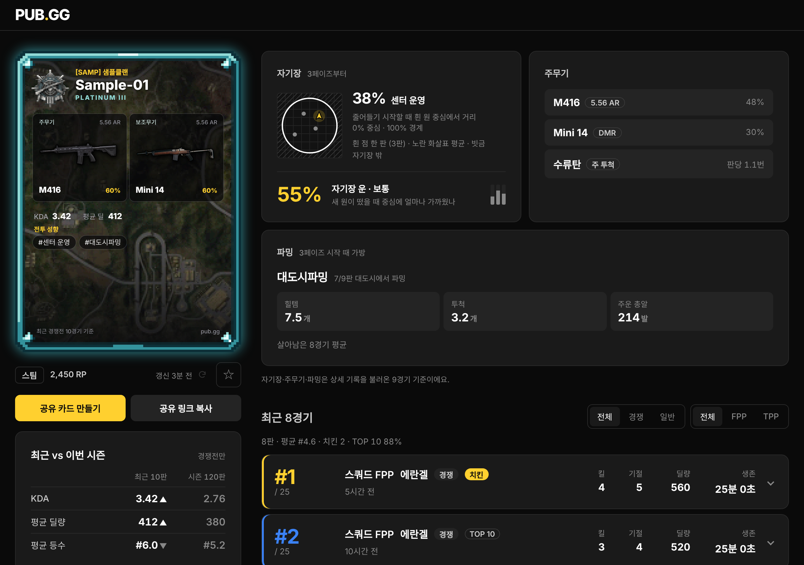
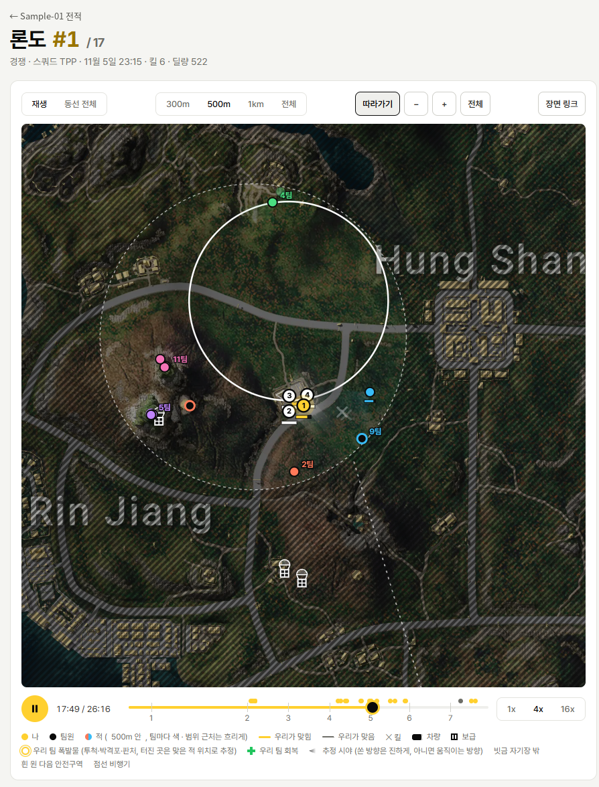

# 펍지지 (PUB.GG)

[](https://github.com/IIN0Ru/pubgg/actions/workflows/test.yml)

배그 닉네임으로 전적과 플레이 스타일을 분석하고, 디스코드·커뮤니티에 공유할 수 있는 카드를 만들어 주는 사이트.




닉네임으로 검색한 결과 화면 (PC, 다크). 왼쪽에 공유용 플레이어 카드와 최근 vs 시즌 비교, 오른쪽에 자기장·주무기·파밍 상세와 최근 경기 목록이 나온다(샘플).



2D 리플레이. 재생/배속/타임라인, 자기장, 우리 팀/근처 적의 동선, 교전, 차량/보급 위치를 지도 위에 그린다.

## 기술

| 영역 | 사용 |
|---|---|
| 서버 | Java 21, Spring Boot 3.5, Maven (JSON API + 링크 미리보기용 껍데기 하나만 Thymeleaf) |
| 검색 결과 화면 | React 19, TypeScript(strict), Vite, TanStack Query, Zustand |
| 저장소 | PostgreSQL (운영), 파일 (로컬) |
| 데이터 | PUBG 공식 API (매치/텔레메트리/시즌) |
| 테스트·배포 | JUnit/Mockito, vitest·Testing Library, GitHub Actions, Docker (Render) |

## 설계에서 신경 쓴 것

- **Spring JSON API + React/TS 분리**: 검색 결과 화면만 React로 옮기고, 서버는 원시값만 준다. 응답 모양은 도메인 객체와 따로 둬서 내부가 바뀌어도 화면 계약이 안 바뀐다
- **링크 미리보기는 서버가 채운다**: 디스코드·카톡 크롤러는 JS를 실행하지 않으므로, `/s/{id}`의 제목·설명·`og:image`는 서버가 `<head>`에 넣는다
- **서버 상태와 화면 상태를 나눔**: 전적은 React Query, 필터·즐겨찾기·최근 검색은 Zustand
- **오래 걸리는 계산은 뒤로**: 텔레메트리 분석은 느려서 카드는 뒤에서 계산하고, 화면은 `pending` 동안 3초마다 다시 묻는다. 분석 결과는 DB에 저장해 재검색을 빠르게 한다
- **오류는 `code`로 나눠 보여준다**: 없는 플레이어 / 요청 한도(남은 초 표시) / 서버 오류
- **카드 도용 문제를 구조로 해결**: 기록만 담긴 수정 불가 A카드와, 공유할 때만 만드는 일회용 B카드로 나눴다
- **지도 4장을 조각 1,364장으로**: 8192px 지도를 512px 조각 5단계로 잘라 보이는 만큼만 불러온다 ([설명](docs/map-tiles.md))
- **Java·프론트 테스트를 모두 CI에서 돌린다**: PUBG API 키 없이 예시 응답과 가짜 서비스만으로 동작

## 구조

```
브라우저 ──GET /search?platform=steam&nickname=…──▶ Spring: 화면 껍데기(app.html)만 바로 응답 (링크 미리보기용 <head> 포함)
   │                                                   │
   └─ React(frontend/) 가 껍데기 안에서 실행 ──GET /api/players/steam/닉네임──▶ Spring: JSON (저장된 결과 / PUBG API)
                                                       └─ 오류는 { code, message, retryAfterSec? } + HTTP 상태
```

모든 화면(첫 화면·전적·카드 꾸미기·2D 리플레이)은 React가 그린다. 자세한 폴더 구조와 API는 [구조](docs/architecture.md).

## 실행

```
export PUBG_API_KEY=키      # developer.pubg.com 에서 발급 (Windows 는 환경 변수에 등록)
mvn spring-boot:run          # http://localhost:8080
```

IntelliJ 설정, 프론트 개발(`npm run dev`), 테스트는 [실행 방법](docs/getting-started.md). Docker·환경 변수는 [배포](docs/deployment.md).

## 문서

| 문서 | 내용 |
|---|---|
| [기능 현황](docs/features.md) | 만든 것, 안 하기로 한 것, 다음 할 일 |
| [구조](docs/architecture.md) | 요청 흐름, API, 폴더 구조 |
| [실행 방법](docs/getting-started.md) | IntelliJ·터미널 실행, 프론트 개발, 테스트 |
| [배포](docs/deployment.md) | Docker, PostgreSQL, 환경 변수 |
| [리플레이 지도 조각](docs/map-tiles.md) | 지도 조각을 왜·어떻게 만들었는지 |
| [자료 출처·디자인](docs/credits.md) | 사용한 공식 자료, 디자인 기준 |
| [개발 기록](NOTES.md) | 기능마다 무엇을 정했고 AI와 어떻게 만들었는지, 어디서 방향을 바꿨는지 |

## 개발 방식 (AI 활용)

AI를 활용해 만든 개인 프로젝트다.

- 기획/기능 범위/판정 기준/디자인 방향과 최종 결정: 본인
- 구현: Claude
- 검토: GPT가 검토 요청서(체크리스트)를 쓰고, Claude가 화면을 직접 띄워 본 리뷰와 합쳐 우선순위(P0/P1/P2)로 정리 → 본인 승인 후 반영
- 기능마다 무엇을 정했고, AI에게 무엇을 시켰고, 어디서 방향을 바꿨는지는 [`NOTES.md`](NOTES.md)에 남긴다.

## 안내

KRAFTON·PUBG와 관련이 없는 비공식 사이트다. PLAYERUNKNOWN'S BATTLEGROUNDS와 PUBG는 KRAFTON, Inc.의 등록 상표 또는 서비스 마크다. 게임 그림 파일(지도·티어 아이콘·무기)의 권리는 KRAFTON에 있다 ([자료 출처](docs/credits.md)).
